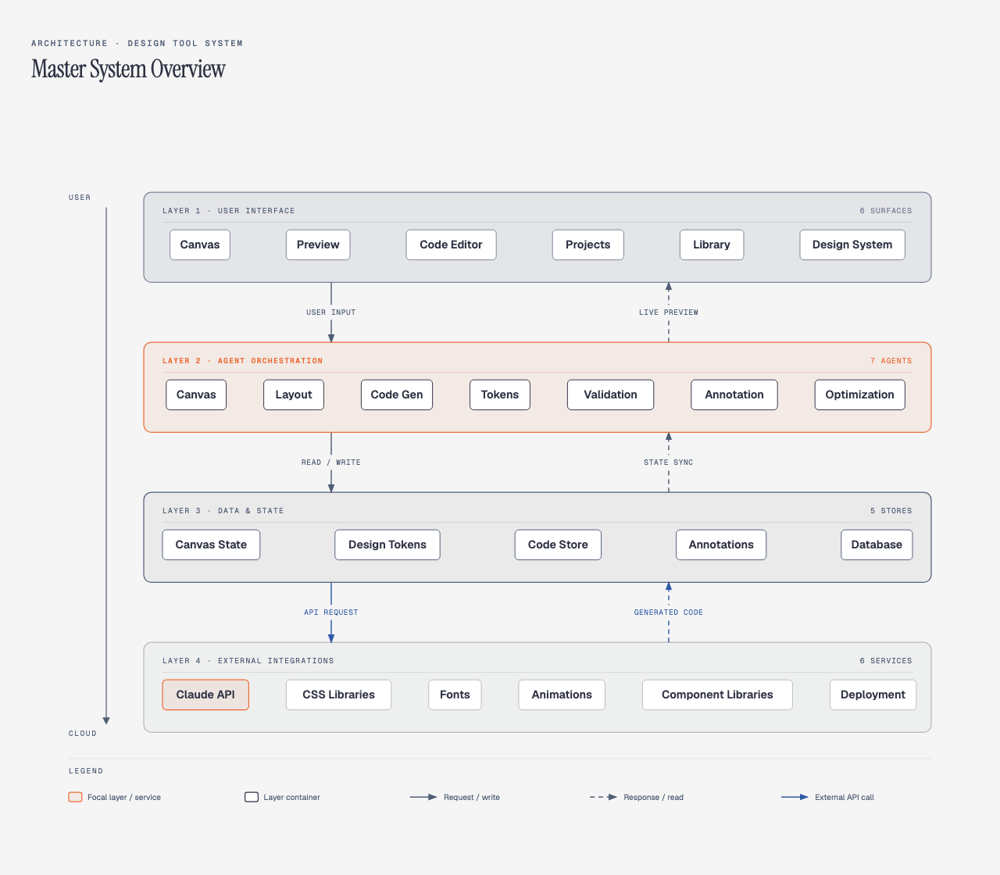
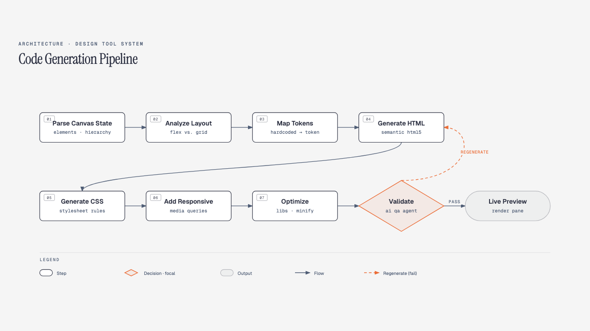
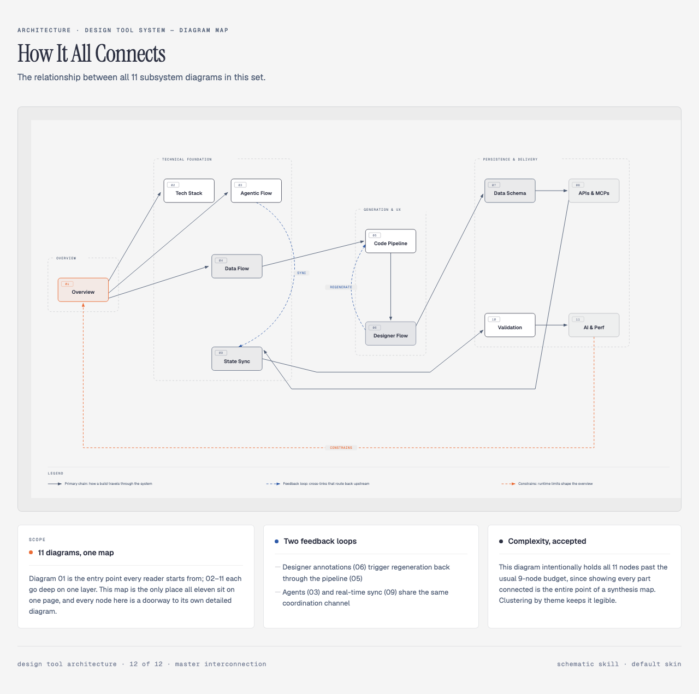

# Vectory

A design canvas that writes real HTML and CSS as you draw. A designer places shapes, text and
images on a Figma-style canvas; an LLM turns the canvas state into semantic, exportable markup
as they work, with a live preview and a code panel that stays open, so the output is never a
black box. First-version scope: static marketing sites, with design tokens, responsive
breakpoints and one-click deploy.

**On hold until PIIIX has the funding to build it.** No application code exists. What exists is
the research and the architecture: twelve diagrams and a competitive pass, kept here so the
thinking survives the pause. Until then, [ArtCraft](https://getartcraft.com/) and
[Storytold](https://github.com/storytold) cover similar ground.

## The architecture, as drawn

  

All twelve: [`assets/01.png`](./assets/01.png) through [`assets/12.png`](./assets/12.png). The
client/server split, the codegen pipeline, the data model, real-time sync, deploy.

## Why it was worth drawing

The AI design-tool market is crowded at a glance: canvas-plus-codegen for React apps exists,
and the no-code builders are well funded. Static marketing-site HTML and CSS, built from a
canvas as the entry point and exported as plain files you own, was still open. The diagrams
are the answer to "what would it take", written down before anyone wrote a line of product
code.

## License

[MIT](./LICENSE) · a [PIIIX](https://github.com/PIIIX-org) concept.

<!-- forged-with: git-a-profile -->
Forged with <a href="https://github.com/PIIIX-org/git-a-profile">git-a-profile</a> · <a href="https://github.com/PIIIX-org">PIIIX</a>
