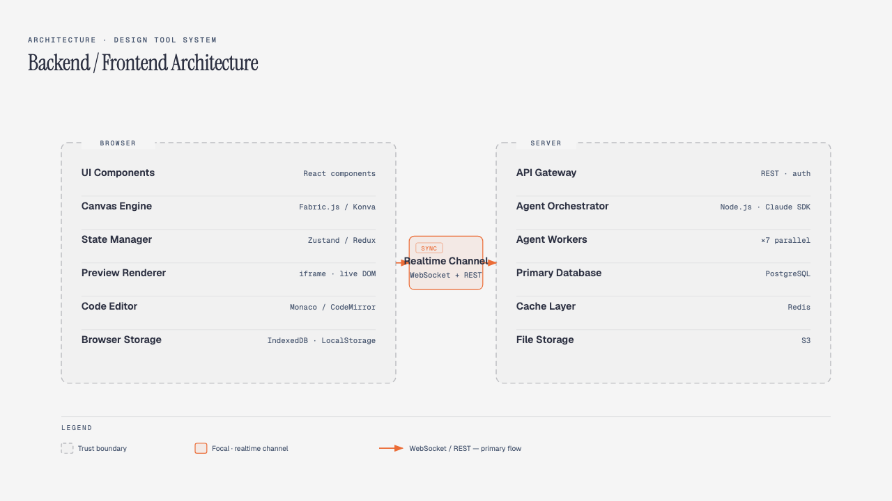
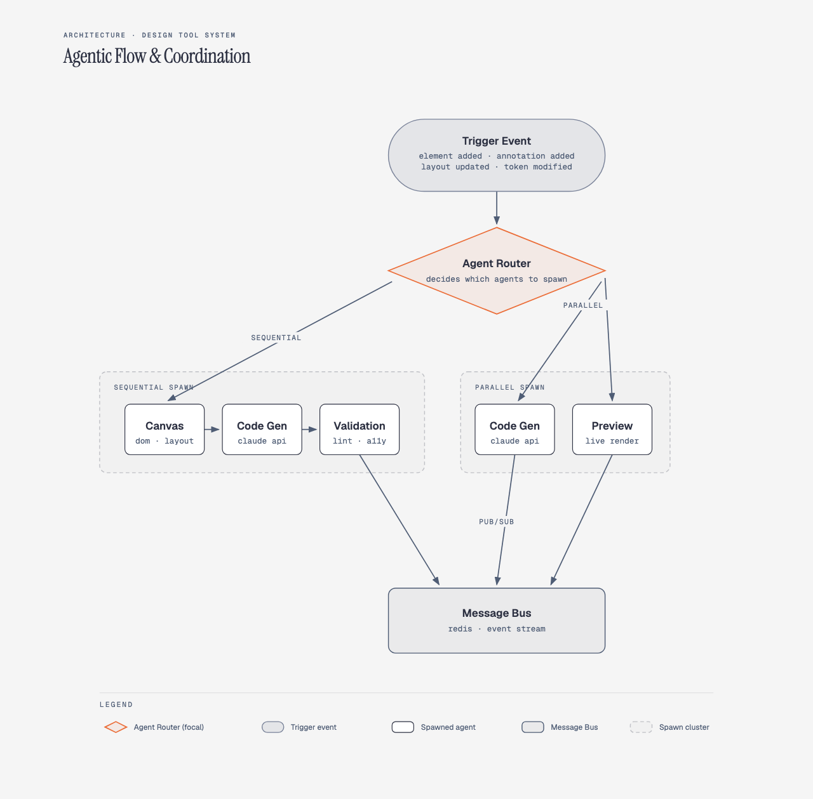
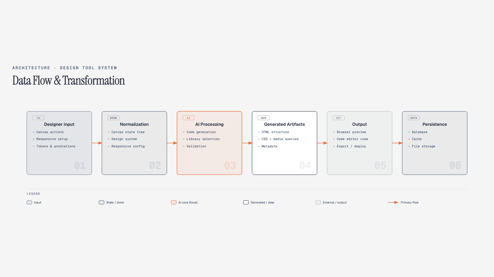
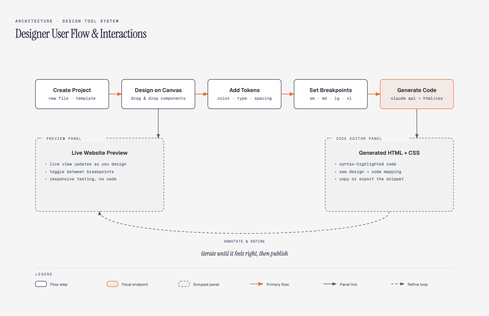
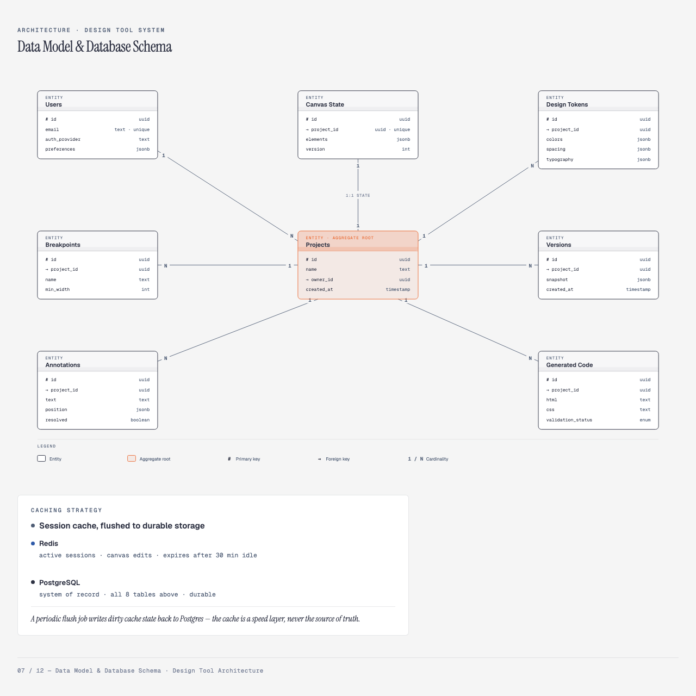
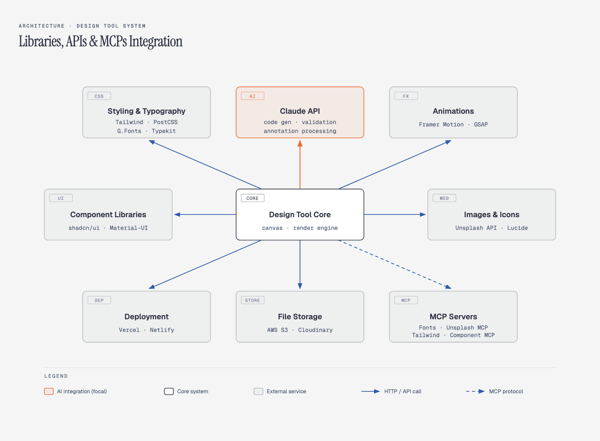
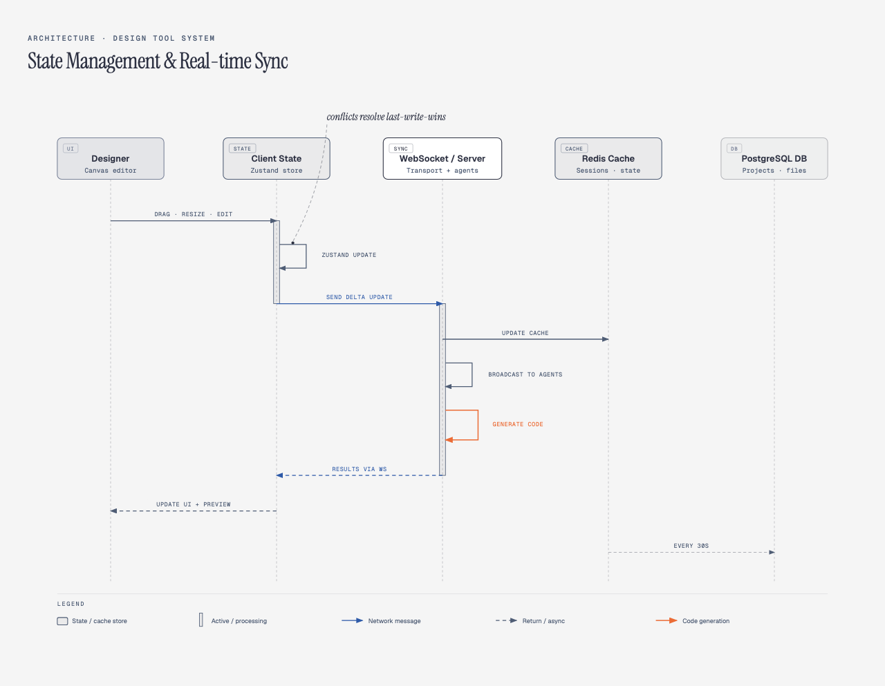
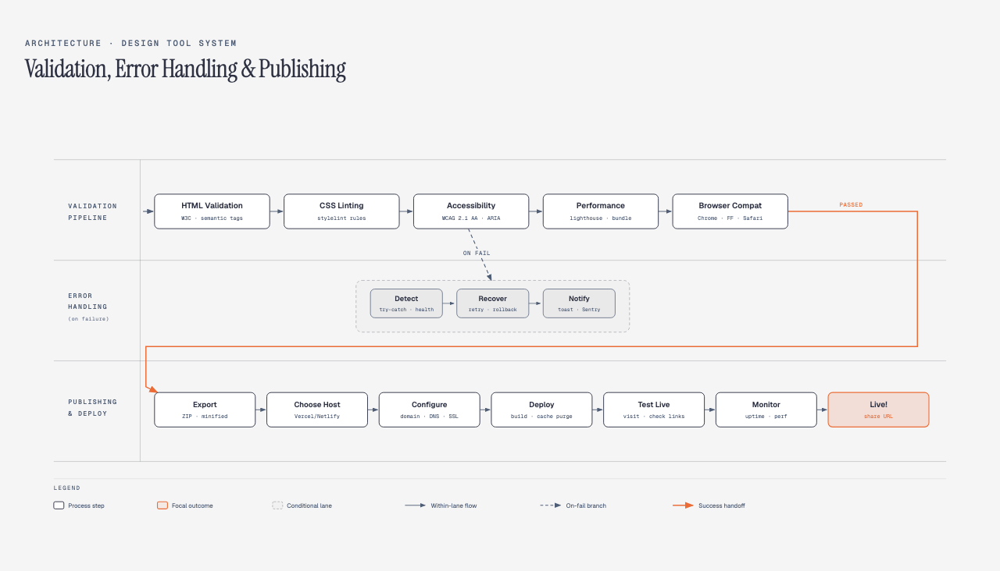
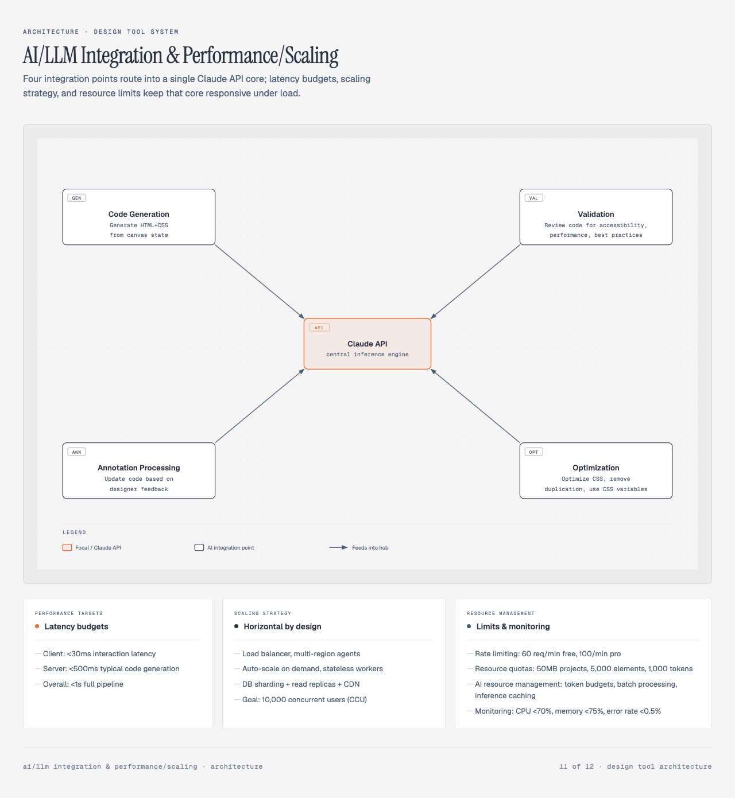

# Vectory

**Status: concept stage — architecture and market research, no code yet.**

Vectory is a proposed web-based design tool that pairs a Figma/Illustrator-style
drag-and-drop canvas with real-time AI code generation. A designer builds a page
visually; an LLM (Claude) turns the canvas state into semantic, production-ready
HTML5 + CSS as they work, with a live preview pane and an optional code editor
panel so the generated output is never a black box.

The goal is to sit in the gap between two extremes: no-code builders that hide
the code entirely (fast, but you're locked in and the output is often bloated),
and hand-coding (fully transparent, but slow to ship a marketing site). Vectory
keeps the designer in a familiar canvas UX while making the code a first-class,
inspectable, exportable artifact.

**Target user:** designers who want to ship a real website without becoming
developers. **Secondary:** developers who want a faster prototyping loop.
**Scope for a first version:** static marketing sites — canvas with shapes,
text, images, groups and layers; design tokens; responsive breakpoints;
real-time preview; one-click deploy to Vercel/Netlify.

This repo is a living research and architecture space, not a shipped product.
It exists to think through the system before writing a line of application
code, and to track how the competitive landscape moves while that thinking
happens.

## What's here

- **[`diagrams/`](diagrams)** — 12 self-contained architecture diagrams (HTML
  + inline SVG, open directly in a browser) covering the full system: layer
  overview, client/server split, agent orchestration, data flow, the code-gen
  pipeline, designer UX, data model, third-party integrations, real-time sync,
  validation/publishing, AI performance budgets, and a master map of how all
  eleven connect.
- **[`RESEARCH.md`](RESEARCH.md)** — competitive landscape research: who else
  is building in this space (AI-native prompt-to-app tools, design-to-code
  converters, AI UI generators, established no-code builders), how they
  actually generate code, and where the gap is for a new entrant.

## Diagram gallery

| # | Diagram | |
|---|---|---|
| 01 | Master System Overview |  |
| 02 | Backend / Frontend Architecture |  |
| 03 | Agentic Flow & Coordination |  |
| 04 | Data Flow & Transformation |  |
| 05 | Code Generation Pipeline |  |
| 06 | Designer User Flow & Interactions |  |
| 07 | Data Model & Database Schema |  |
| 08 | Libraries, APIs & MCPs Integration |  |
| 09 | State Management & Real-time Sync |  |
| 10 | Validation, Error Handling & Publishing |  |
| 11 | AI/LLM Integration & Performance/Scaling |  |
| 12 | Master Interconnection Diagram |  |

Click any thumbnail to open the interactive HTML/SVG version.

## Why "static marketing sites" first

Full app builders (auth, databases, business logic) are a much harder AI
code-generation problem — state management and backend logic don't degrade
gracefully when an LLM gets something subtly wrong. Static marketing pages do:
worst case, a section looks off and gets tweaked. That makes it a sane wedge
to prove out canvas-to-code quality before ever touching app logic.

## Status & next steps

No implementation exists yet. Open questions being tracked in `RESEARCH.md`
and worth resolving before writing code: whether the canvas-first UX is
actually the differentiator (versus code quality or price), and whether
several incumbents listed there are already closing this gap faster than a
new entrant could catch up.
